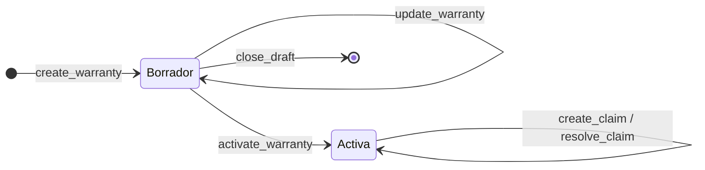
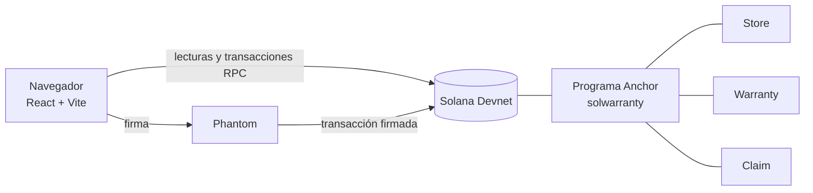

<div align="center">

<picture>
  <source media="(prefers-color-scheme: dark)" srcset="frontend/public/img/SolWarranty_logo.svg">
  
</picture>

**Garantías de productos verificables en Solana.**
Una tienda registra la garantía, el comprador la reclama y cualquiera puede comprobarla en la cadena.


[Programa en Explorer](https://explorer.solana.com/address/7uYrQU8oTEK7JaPfAcZPQSQcJLMs2BmxfmVkc1iSbFp4?cluster=devnet) ·
[Guía de implementación](docs/IMPLEMENTACION.md) ·
[Matriz de pruebas](docs/IMPLEMENTACION.md#5-matriz-de-aceptación-on-chain)

</div>

---

> **Prototipo académico** (ruta de entrega: proyecto propio). El programa está desplegado en Devnet y el frontend ya apunta a él, pero **las pruebas on-chain completas aún no se han ejecutado**. Consulta el [estado del proyecto](#estado-del-proyecto).

## Contenido

- [Qué hace](#qué-hace)
- [Cómo funciona](#cómo-funciona)
- [Inicio rápido](#inicio-rápido)
- [Configuración](#configuración)
- [Arquitectura](#arquitectura)
- [Contrato](#contrato)
- [Frontend](#frontend)
- [Reglas de negocio](#reglas-de-negocio)
- [Redesplegar el contrato](#redesplegar-el-contrato)
- [Estado del proyecto](#estado-del-proyecto)

## Qué hace

SolWarranty guarda cada garantía como una cuenta en la blockchain. Así ni la tienda ni el comprador pueden alterarla después, y cualquiera puede verificarla sin pedir permiso a nadie.

| Rol | Qué puede hacer |
|---|---|
| **Tienda** | Registrarse, crear garantías en borrador, editarlas, activarlas, cerrar borradores y resolver reclamos. |
| **Comprador** | Ver sus garantías y abrir un reclamo (pantalla, batería, carga u otro) mientras la garantía esté vigente. |
| **Cualquier persona** | Verificar una garantía y sus reclamos desde su dirección, sin conectar wallet. |

Los datos sensibles **no se guardan en la cadena**: el número de serie, el recibo y la descripción del reclamo se almacenan como hashes SHA-256 de 32 bytes.

## Cómo funciona



Un reclamo tiene su propio ciclo: nace **Abierto** y termina **Resuelto** con resolución **Aceptada** o **Rechazada**. Solo puede haber un reclamo abierto por garantía.

## Inicio rápido

**Requisitos:** Node.js 20 o superior, la extensión [Phantom](https://phantom.app) configurada en **Devnet** y algo de SOL de prueba (faucet: <https://faucet.solana.com>).

```bash
git clone <url-del-repositorio>
cd solwarranty/frontend
cp .env.example .env
npm ci
npm run dev
```

Abre <http://localhost:5173>, conecta Phantom y registra tu tienda desde `/store`.

| Comando | Para qué sirve |
|---|---|
| `npm run dev` | Servidor de desarrollo con recarga en caliente |
| `npm run build` | Comprueba tipos con `tsc` y genera `dist/` |
| `npm run preview` | Sirve la compilación de producción |

## Configuración

El archivo `frontend/.env` usa tres variables. Ninguna contiene claves privadas.

| Variable | Valor por defecto | Descripción |
|---|---|---|
| `VITE_SOLANA_CLUSTER` | `devnet` | Red de Solana |
| `VITE_SOLANA_RPC_URL` | `https://api.devnet.solana.com` | Endpoint RPC. Si te limita por exceso de peticiones, usa uno propio. |
| `VITE_PROGRAM_ID` | `7uYrQU8oTEK7JaPfAcZPQSQcJLMs2BmxfmVkc1iSbFp4` | ID del programa desplegado |

La app lee la IDL de `frontend/public/solwarranty.json` y se niega a operar si su `address` no coincide con `VITE_PROGRAM_ID`, para evitar firmar contra un programa equivocado.

## Arquitectura



- El frontend consulta las cuentas directamente por RPC, sin servidor intermedio. Las garantías se filtran en el nodo por `store` o por `buyer`; no se descargan todas para filtrar en el navegador.
- La verificación pública usa un cliente Anchor de solo lectura. Las operaciones usan un `AnchorProvider` con la wallet conectada.
- Los permisos, las relaciones entre cuentas, la vigencia y el cierre de borradores los aplica el contrato. Los botones deshabilitados de la interfaz son solo una ayuda visual.

## Contrato

Código fuente: [`contract/programs/solwarranty/src/lib.rs`](contract/programs/solwarranty/src/lib.rs) · Anchor, Program ID `7uYrQU8oTEK7JaPfAcZPQSQcJLMs2BmxfmVkc1iSbFp4`.

### Instrucciones

| Instrucción | Quién firma | Efecto |
|---|---|---|
| `initialize_store` | Tienda | Crea la tienda de la wallet (nombre de hasta 48 bytes) |
| `create_warranty` | Tienda | Crea una garantía en borrador para un comprador |
| `update_warranty` | Tienda | Edita una garantía mientras es borrador |
| `activate_warranty` | Tienda | Activa la garantía y fija fechas con el reloj on-chain |
| `create_claim` | Comprador | Abre un reclamo sobre una garantía activa y vigente |
| `resolve_claim` | Tienda | Acepta o rechaza el reclamo abierto |
| `close_draft` | Tienda | Cierra un borrador y devuelve el alquiler (rent) |

### Cuentas (PDAs)

| Cuenta | Semillas | Datos principales |
|---|---|---|
| `Store` | `["store", authority]` | autoridad, nombre, `next_warranty_id`, `draft_count` |
| `Warranty` | `["warranty", store, warranty_id (u64 LE)]` | comprador, producto, hashes, duración, fechas, estado |
| `Claim` | `["claim", warranty, claim_id (u64 LE)]` | reclamante, motivo, hash de descripción, estado, resolución |

### Errores del programa

| Código | Nombre | Mensaje |
|---|---|---|
| 6000 | `Unauthorized` | Wallet no autorizada |
| 6001 | `WarrantyNotDraft` | La garantía debe estar en borrador |
| 6002 | `WarrantyNotActive` | La garantía debe estar activa |
| 6003 | `WarrantyExpired` | La garantía ha vencido |
| 6004 | `ClaimAlreadyOpen` | Ya existe una reclamación abierta |
| 6005 | `ClaimNotOpen` | La reclamación no está abierta |
| 6006 | `InvalidWarrantyId` | ID de garantía inesperado |
| 6007 | `InvalidClaimId` | ID de reclamación inesperado |
| 6008 | `InvalidDuration` | Duración inválida |
| 6009 | `NameTooLong` | Texto demasiado largo o vacío |
| 6010 | `Overflow` | Desbordamiento aritmético |
| 6011 | `ActiveClaimsExist` | Hay reclamaciones abiertas |
| 6012 | `InvalidBuyer` | Comprador inválido |
| 6013 | `InvalidResolution` | Resolución inválida |

## Frontend

### Rutas

| Ruta | Quién la usa | Para qué |
|---|---|---|
| `/` | Todos | Presentación y conexión de wallet |
| `/store` | Tienda | Panel: registrar tienda y listar garantías |
| `/store/warranties/new` | Tienda | Crear un borrador |
| `/store/warranties/:id` | Tienda | Editar, activar, cerrar y resolver reclamos |
| `/my-warranties` | Comprador | Garantías asociadas a la wallet |
| `/verify/:warrantyPda` | Todos | Verificación pública y apertura de reclamos |

### Estructura

```text
solwarranty/
├── contract/programs/solwarranty/src/lib.rs   Programa Anchor
├── docs/IMPLEMENTACION.md                     Guía y matriz de pruebas T01–T14
└── frontend/
    ├── public/
    │   ├── solwarranty.json                   IDL del programa desplegado
    │   └── img/                               Logo e isotipo en SVG
    ├── scripts/convert-idl.mjs                Convierte IDL antiguas de Playground
    └── src/
        ├── solana/                            config, PDAs, programa, consultas y transacciones
        ├── hooks/                             useChainData, useTransaction
        ├── components/                        formularios, tarjeta y estado de transacción
        └── pages/                             una página por ruta
```

## Reglas de negocio

- **Duración:** de 1 a 730 días.
- **Textos:** producto de 1 a 64 bytes UTF-8; tienda de hasta 48 bytes.
- **Hashes:** serie, recibo y descripción se envían como SHA-256 de 32 bytes. No introduzcas datos personales.
- **IDs:** los de garantía y reclamo son contadores que solo avanzan. Cerrar un borrador reduce `draft_count`, pero **no reutiliza** su ID.
- **Reclamos:** solo uno abierto por garantía, y solo mientras esté vigente. La vigencia se calcula con el reloj on-chain; el frontend solo la muestra.
- **Permanencia:** las garantías activas y los reclamos resueltos permanecen en la cadena. Solo se pueden cerrar borradores.

## Redesplegar el contrato

El programa actual ya está desplegado. Estos pasos son solo si cambias `lib.rs`:

1. Copia `lib.rs` a un proyecto Anchor en [Solana Playground](https://beta.solpg.io), compila y despliega en **Devnet**.
2. Actualiza `declare_id!` en `lib.rs` y `VITE_PROGRAM_ID` en `frontend/.env` con el nuevo ID.
3. Descarga la IDL del build y ponla en `frontend/public/solwarranty.json`. Playground suele generar el formato antiguo (Anchor 0.29), que el cliente no acepta; conviértela con:

   ```bash
   cd frontend
   node scripts/convert-idl.mjs ruta/idl.json public/solwarranty.json <PROGRAM_ID>
   ```

4. Reinicia `npm run dev` y repite el flujo completo con dos wallets.

No mantengas una IDL de un build anterior después de cambiar el contrato.

## Estado del proyecto

| Elemento | Estado |
|---|---|
| Programa Anchor | Desplegado en Devnet |
| IDL | Generada del mismo `lib.rs`; coincide con la IDL descargada de Playground |
| Frontend | Compila con `npm run build` y apunta al programa |
| Simulación de `initialize_store` en Devnet | Aceptada |
| Pruebas on-chain completas (T01–T14) | **Pendientes** |
| Firmas de transacciones en Devnet documentadas | **Pendientes** |

Antes de dar el proyecto por terminado hay que ejecutar la [matriz T01–T14](docs/IMPLEMENTACION.md#5-matriz-de-aceptación-on-chain) con tres wallets (tienda, comprador y ajena) y registrar, para cada caso, el estado inicial, el resultado observado y la firma o el error de Anchor. No se deben inventar evidencias de Devnet.
