# Evidencias en Devnet

Comprobantes del funcionamiento de SolWarranty contra el programa desplegado en **Solana Devnet**. Todo lo de esta página se puede verificar en la cadena; las capturas son de la aplicación local (`localhost:5173`) conectada con Phantom.

- **Programa:** [`7uYrQU8oTEK7JaPfAcZPQSQcJLMs2BmxfmVkc1iSbFp4`](https://explorer.solana.com/address/7uYrQU8oTEK7JaPfAcZPQSQcJLMs2BmxfmVkc1iSbFp4?cluster=devnet)
- **Wallet de la tienda:** `9pnNJ23oyTxKvbH1QUDE7KsWdNPepi8moxPWcgt19YZC`
- **Wallet del comprador:** `GkpTRCHoSmcz7ikrPatGP95vqBcgZgFqMMV5g6sKsXA`
- **Periodo:** del 21 al 22 de noviembre de 2026 (UTC).

## 1. Transacciones verificables

Las 13 transacciones terminaron con éxito (ninguna con error). Cada firma enlaza a Solana Explorer.

| # | Fecha (UTC) | Instrucción | Firmó | Detalle | Verificar |
|---|---|---|---|---|---|
| 1 | 2026-11-21 03:22:34 | `despliegue` | Wallet del comprador | Despliegue o actualización del programa en Devnet | [`3sEo6ELk…`](https://explorer.solana.com/tx/3sEo6ELk4oJe2Ewh2BooyMy1FHdaN9CYmZmnaR65JYHSSqU3DxMfzU2ZQakeKH5sS3V2yfZhXi8s953JxCziqwLs?cluster=devnet) |
| 2 | 2026-11-21 03:48:07 | `initialize_store` | Tienda | Registra la tienda «Don juan» | [`2nE4oXee…`](https://explorer.solana.com/tx/2nE4oXeea1S5Q2xWVuHf4kgFtW71PtA3a6mW5wZcs94YS8RtVvZeNWXT2szcECrfg4Q98puYWskGFJ1MY4Uwpmm5?cluster=devnet) |
| 3 | 2026-11-21 21:47:54 | `create_warranty` | Tienda | Crea la garantía #0 «Iphone 14» | [`5do6MtYg…`](https://explorer.solana.com/tx/5do6MtYgaD3nTVNGU2TZR5cVSTBzZn6kLeHLjzouyH61NVbeqMyhTc3FRKFCXPxt4M6p8R1LU4VcoNRKFEqycnVh?cluster=devnet) |
| 4 | 2026-11-21 21:55:11 | `activate_warranty` | Tienda | Activa la garantía #0 | [`5GN1H1me…`](https://explorer.solana.com/tx/5GN1H1me9RrsB4iPmhg4n6AbRUnCcTmqKZMZoQcDCpToZYJskLXYkgyM7vENXTJBcfAcmqRHNCP8UZpSs3sjyLQ6?cluster=devnet) |
| 5 | 2026-11-21 22:23:04 | `create_claim` | Comprador | Reclamación 0 sobre #0 (batería) | [`LB1Sfbph…`](https://explorer.solana.com/tx/LB1Sfbph2t9UjZEXCMhEw41yKVR4gxs9bDWyJ9Xx5jauPCCpcnDQ2rbXcVCtBCdfYqdfmwD5XoJydMcNPpBRSSR?cluster=devnet) |
| 6 | 2026-11-22 01:21:13 | `create_warranty` | Tienda | Crea la garantía #1 «Tablet Samsung» | [`62M6KfZP…`](https://explorer.solana.com/tx/62M6KfZPjsHAKcoV4boBeBLRHVfu92bDr2ZvSCFyVHQkETnRmXUzNhHz33xLKBMgWju7bLLEfzVu8TkfY5EGjr19?cluster=devnet) |
| 7 | 2026-11-22 01:21:45 | `activate_warranty` | Tienda | Activa la garantía #1 | [`66F8R9BF…`](https://explorer.solana.com/tx/66F8R9BFFEj5r4jGbbAAHzQmDRXjYZd6Krm9iMKgBeNJrHEdd9HisJpJKzXe32mrV9VBg86AcoKCNKLs1xLs3tDN?cluster=devnet) |
| 8 | 2026-11-22 02:38:30 | `resolve_claim` | Tienda | Resuelve la reclamación 0 de #0: **aceptada** | [`F7zfxntJ…`](https://explorer.solana.com/tx/F7zfxntJ6fVAN5zKomXp9NH7FbKdBVeDNMZZmKa4avQbmENCW5mfrkUunyxPWGTyMco9iPSHvGwndjW9xdUaWbZ?cluster=devnet) |
| 9 | 2026-11-22 02:41:02 | `create_claim` | Comprador | Reclamación 1 sobre #0 (carga) | [`3cmTZ5bR…`](https://explorer.solana.com/tx/3cmTZ5bR475d6KLPeNJ52fxbVhymdVLWJD5CoXD7vwq5dkHVziFhnf5zecRMaBztuiX5zdn1byKtxxxcVhLWfb3i?cluster=devnet) |
| 10 | 2026-11-22 02:41:49 | `resolve_claim` | Tienda | Resuelve la reclamación 1 de #0: **rechazada** | [`3frJAU1y…`](https://explorer.solana.com/tx/3frJAU1yofhbsdYxVusyJaQULUFdbqJwfY11air57XcY1vG8u2fMBmBgBjsr9nx7dR773GvgTcYjjRrwWebVbT2W?cluster=devnet) |
| 11 | 2026-11-22 02:44:22 | `create_warranty` | Tienda | Crea la garantía #2 «PS5» | [`vr6cJzNX…`](https://explorer.solana.com/tx/vr6cJzNXfFnVbNwEdcK5iAvfGLt7rmoQpxCya3X5jWp76VEdBYvGzyZq2jAU4DppNZDTLPESr6MJd9ZzrnZRxay?cluster=devnet) |
| 12 | 2026-11-22 02:46:13 | `activate_warranty` | Tienda | Activa la garantía #2 | [`4ENJvLcy…`](https://explorer.solana.com/tx/4ENJvLcyjYDGcqfzmywKUMbzgLCdZDzej9uQ4Az5S57Qp1RivBuu4WQ8S6xQbRuEVM7wHArdJ7PCyzkCE2CcYhWg?cluster=devnet) |
| 13 | 2026-11-22 02:47:54 | `create_claim` | Comprador | Reclamación 0 sobre #2 (carga) | [`mrGzEKCZ…`](https://explorer.solana.com/tx/mrGzEKCZkVcdqxcLMPgCehNY3K5Bb2tKfbQ75CdpCRjwRsjnuZhSwUUEXqPhZYJTV3g45k1HeaTwikHQ4aXfMss?cluster=devnet) |

<details>
<summary>Firmas completas (para copiar)</summary>

```text
 1. 3sEo6ELk4oJe2Ewh2BooyMy1FHdaN9CYmZmnaR65JYHSSqU3DxMfzU2ZQakeKH5sS3V2yfZhXi8s953JxCziqwLs
 2. 2nE4oXeea1S5Q2xWVuHf4kgFtW71PtA3a6mW5wZcs94YS8RtVvZeNWXT2szcECrfg4Q98puYWskGFJ1MY4Uwpmm5
 3. 5do6MtYgaD3nTVNGU2TZR5cVSTBzZn6kLeHLjzouyH61NVbeqMyhTc3FRKFCXPxt4M6p8R1LU4VcoNRKFEqycnVh
 4. 5GN1H1me9RrsB4iPmhg4n6AbRUnCcTmqKZMZoQcDCpToZYJskLXYkgyM7vENXTJBcfAcmqRHNCP8UZpSs3sjyLQ6
 5. LB1Sfbph2t9UjZEXCMhEw41yKVR4gxs9bDWyJ9Xx5jauPCCpcnDQ2rbXcVCtBCdfYqdfmwD5XoJydMcNPpBRSSR
 6. 62M6KfZPjsHAKcoV4boBeBLRHVfu92bDr2ZvSCFyVHQkETnRmXUzNhHz33xLKBMgWju7bLLEfzVu8TkfY5EGjr19
 7. 66F8R9BFFEj5r4jGbbAAHzQmDRXjYZd6Krm9iMKgBeNJrHEdd9HisJpJKzXe32mrV9VBg86AcoKCNKLs1xLs3tDN
 8. F7zfxntJ6fVAN5zKomXp9NH7FbKdBVeDNMZZmKa4avQbmENCW5mfrkUunyxPWGTyMco9iPSHvGwndjW9xdUaWbZ
 9. 3cmTZ5bR475d6KLPeNJ52fxbVhymdVLWJD5CoXD7vwq5dkHVziFhnf5zecRMaBztuiX5zdn1byKtxxxcVhLWfb3i
10. 3frJAU1yofhbsdYxVusyJaQULUFdbqJwfY11air57XcY1vG8u2fMBmBgBjsr9nx7dR773GvgTcYjjRrwWebVbT2W
11. vr6cJzNXfFnVbNwEdcK5iAvfGLt7rmoQpxCya3X5jWp76VEdBYvGzyZq2jAU4DppNZDTLPESr6MJd9ZzrnZRxay
12. 4ENJvLcyjYDGcqfzmywKUMbzgLCdZDzej9uQ4Az5S57Qp1RivBuu4WQ8S6xQbRuEVM7wHArdJ7PCyzkCE2CcYhWg
13. mrGzEKCZkVcdqxcLMPgCehNY3K5Bb2tKfbQ75CdpCRjwRsjnuZhSwUUEXqPhZYJTV3g45k1HeaTwikHQ4aXfMss
```

</details>

> Solana Explorer muestra «Unknown Instruction» porque la IDL del programa no está publicada en la cadena. Las instrucciones de la tabla se identifican por el discriminador de los datos de cada transacción, contra la IDL de `frontend/public/solwarranty.json`.

## 2. Estado final de las cuentas

Leído de la cadena después de la última transacción.

| Cuenta | Estado |
|---|---|
| **Tienda** «Don juan» | Autoridad = wallet de la tienda · `next_warranty_id = 3` · `draft_count = 0` |
| **Garantía #0** «Iphone 14» | Activa · `next_claim_id = 2` · `open_claim_count = 0` |
| **Garantía #1** «Tablet Samsung» | Activa · `next_claim_id = 0` · `open_claim_count = 0` |
| **Garantía #2** «PS5» | Activa · `next_claim_id = 1` · `open_claim_count = 1` |
| **Reclamación** de #0 (batería) | Resuelta · **aceptada** |
| **Reclamación** de #0 (carga) | Resuelta · **rechazada** |
| **Reclamación** de #2 (carga) | **Abierta** (pendiente de que la tienda la resuelva) |

Se observan dos invariantes del contrato: los IDs solo avanzan (`next_warranty_id`, `next_claim_id`) y `open_claim_count` vuelve a 0 al resolver las reclamaciones de #0.

## 3. Capturas

### Flujo de la tienda

#### 1. Formulario de nueva garantía

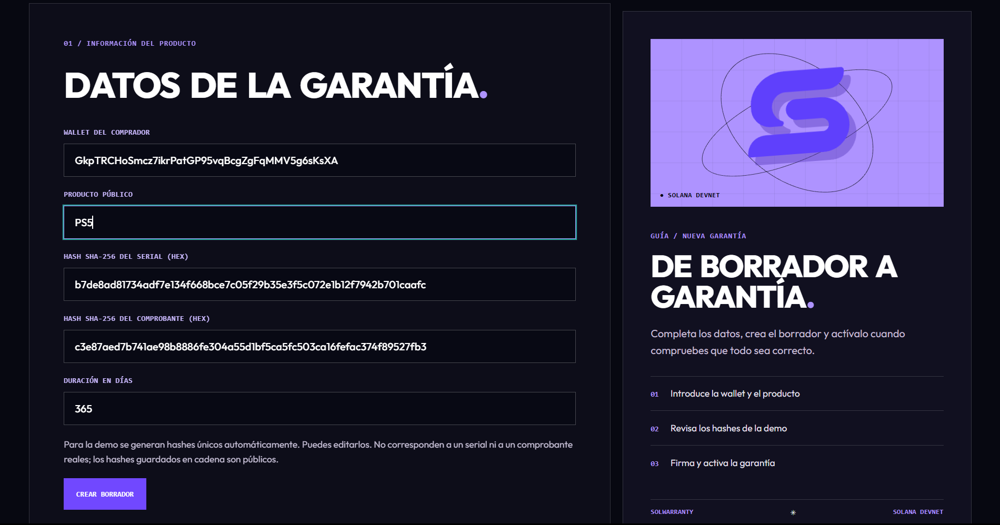

La tienda introduce la wallet del comprador, el producto («PS5»), los hashes SHA-256 de serie y comprobante, y la duración (365 días).

#### 2. Confirmación antes de firmar

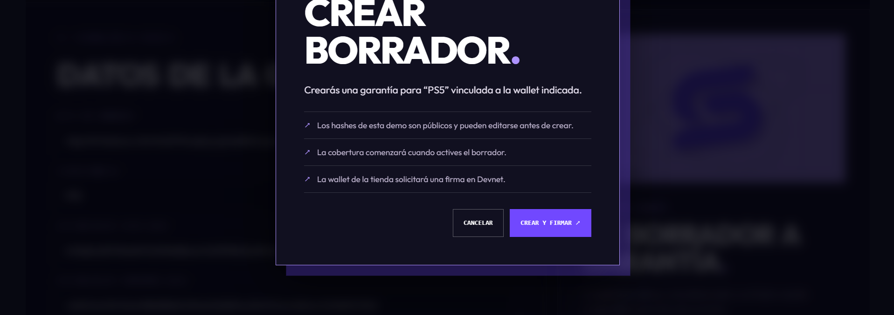

La aplicación resume la acción antes de pedir la firma: se crea un borrador y la cobertura empieza al activarlo.

#### 3. Firma en Phantom (tienda)

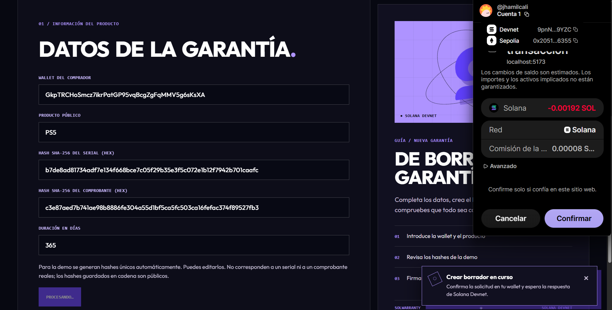

Phantom pide confirmar la transacción en Devnet con la cuenta de la tienda (`9pnN…9YZC`). La aplicación muestra «Crear borrador en curso». Corresponde a la transacción 11 de la tabla.

#### 4. Borrador confirmado

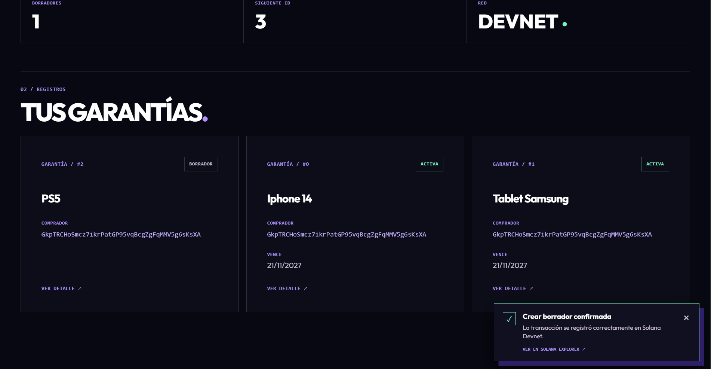

Tras la confirmación aparece «Crear borrador confirmada» con enlace a Solana Explorer. El panel muestra 1 borrador, siguiente ID 3, las garantías #0 y #1 activas y el nuevo borrador #2.

#### 5. Garantía en borrador

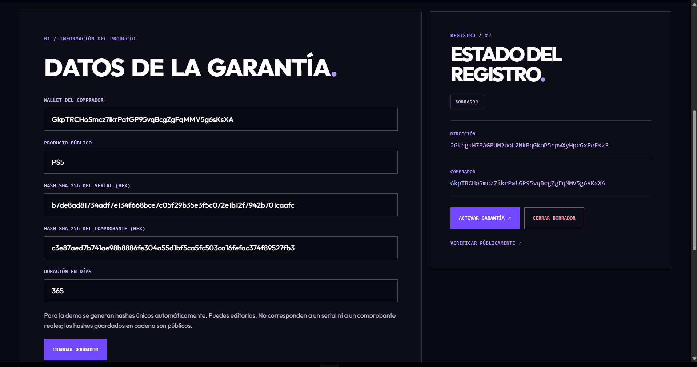

Detalle de la garantía #2 en estado **Borrador**, con las acciones «Activar garantía» y «Cerrar borrador».

#### 6. Garantía activa

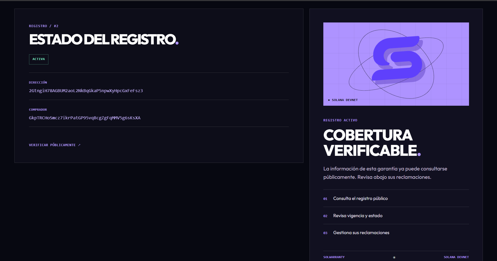

La misma garantía #2 después de activarla (transacción 12): estado **Activa** y acceso a la verificación pública.

### Flujo del comprador

#### 7. Mis garantías

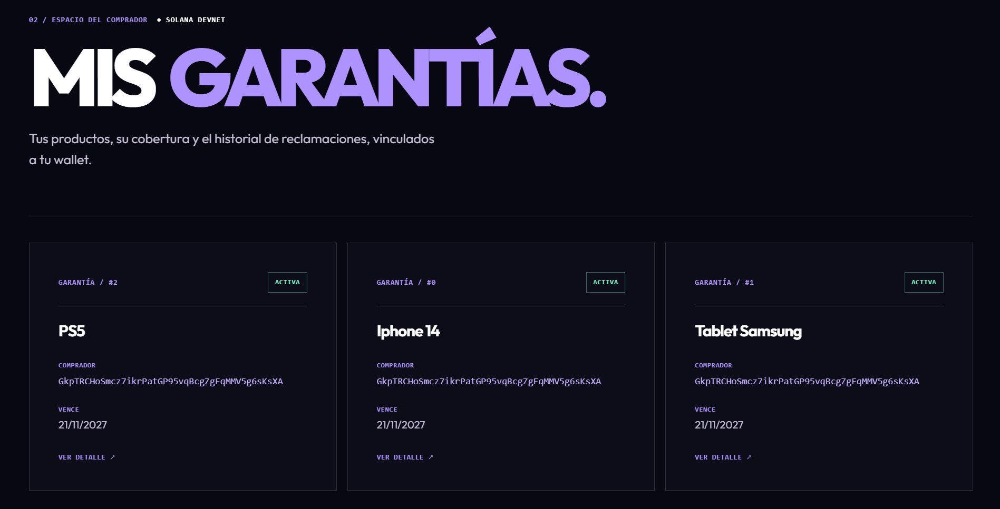

Con la wallet compradora, la lista muestra las tres garantías asociadas (#0, #1 y #2), todas activas y con vencimiento el 21/11/2027.

#### 8. Formulario de reclamación

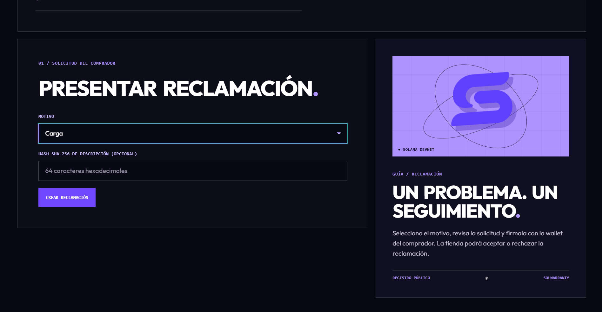

El comprador elige el motivo («Carga») y, opcionalmente, el hash SHA-256 de la descripción.

#### 9. Firma en Phantom (comprador)

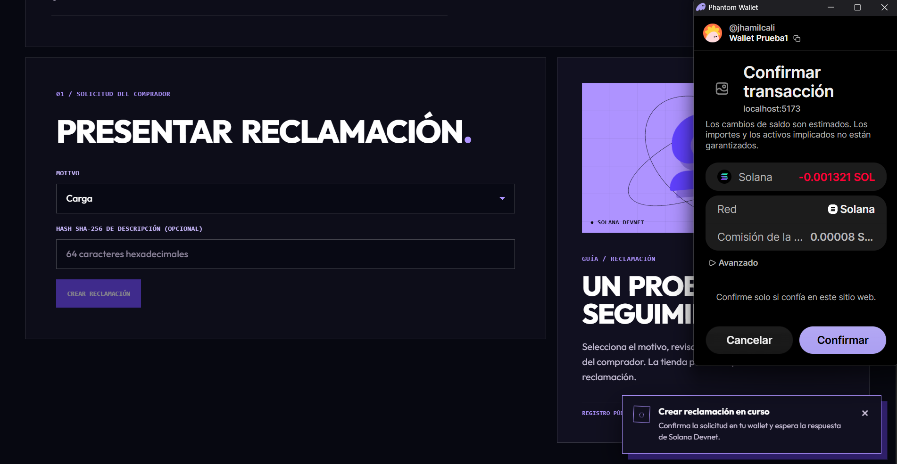

Phantom pide confirmar con la cuenta «Wallet Prueba1» (el comprador). La aplicación muestra «Crear reclamación en curso». Corresponde a la transacción 13.

### Verificación pública

#### 10. Explorador de garantías

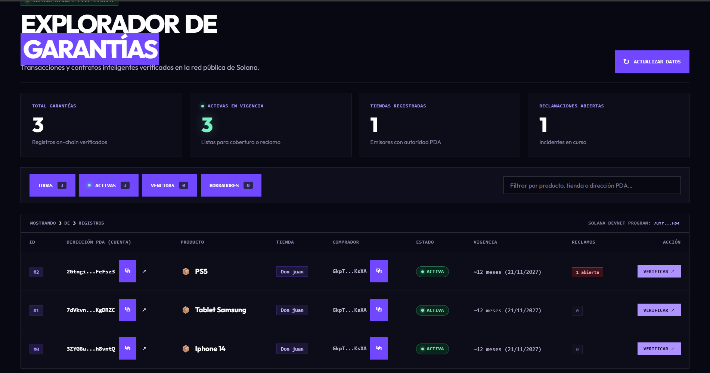

Vista pública con 3 garantías, 3 activas, 1 tienda y **1 reclamación abierta**, que aparece como «1 abierta» en la garantía #2 (PS5).

#### 11. Programa en Solana Explorer

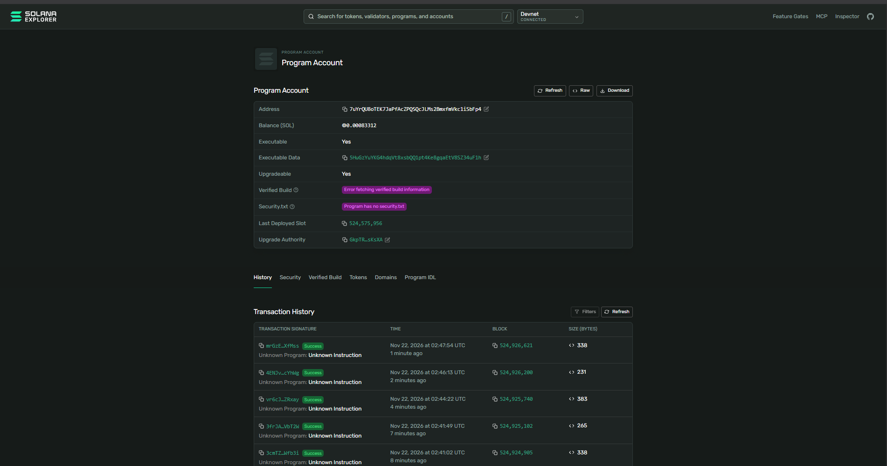

Cuenta del programa en Devnet (ejecutable y actualizable) con su historial de transacciones. Las cinco más recientes coinciden con las firmas `mrGzE…`, `4ENJv…`, `vr6cJ…`, `3frJA…` y `3cmTZ…` de la tabla.

## 4. Cobertura de la matriz de aceptación

Resultado frente a la [matriz T01–T14](IMPLEMENTACION.md#5-matriz-de-aceptación-on-chain). Solo se marca como evidenciado lo que se puede comprobar en la cadena o en las capturas.

| ID | Escenario | Estado | Evidencia |
|---|---|---|---|
| T01 | Wallet A crea Store | **Evidenciado** | Transacción 2 |
| T02 | A crea Warranty en borrador | **Evidenciado** | Transacciones 3, 6 y 11; `next_warranty_id = 3` |
| T03 | A edita el borrador | Pendiente | Sin transacción `update_warranty` |
| T04 | A activa la Warranty | **Evidenciado** | Transacciones 4, 7 y 12; `draft_count = 0` |
| T05 | Wallet B abre una Claim | **Evidenciado** | Transacciones 5, 9 y 13 |
| T06 | A resuelve la Claim | **Evidenciado** | Transacciones 8 (aceptada) y 10 (rechazada); `open_claim_count = 0` en #0 |
| T07 | Wallet C edita la Warranty de A | Pendiente | No se usó una tercera wallet |
| T08 | Resolver Claim de A con Warranty de B | Pendiente | — |
| T09 | Cerrar una Warranty activa | Pendiente | — |
| T10 | Cerrar una Warranty en borrador | Pendiente | Sin transacción `close_draft` |
| T11 | Wallet ajena abre Claim | Pendiente | No se usó una tercera wallet |
| T12 | Abrir Claim tras el vencimiento | Pendiente | Las garantías creadas duran 365 días |
| T13 | Segunda Claim simultánea | Pendiente | — |
| T14 | Resolver una Claim ya resuelta | Pendiente | — |

Los casos de rechazo (T07–T09 y T11–T14) no dejan transacción en la cadena cuando la simulación previa los rechaza, así que su evidencia es la captura del error de la aplicación o el log de Anchor. Aún no se han registrado.
